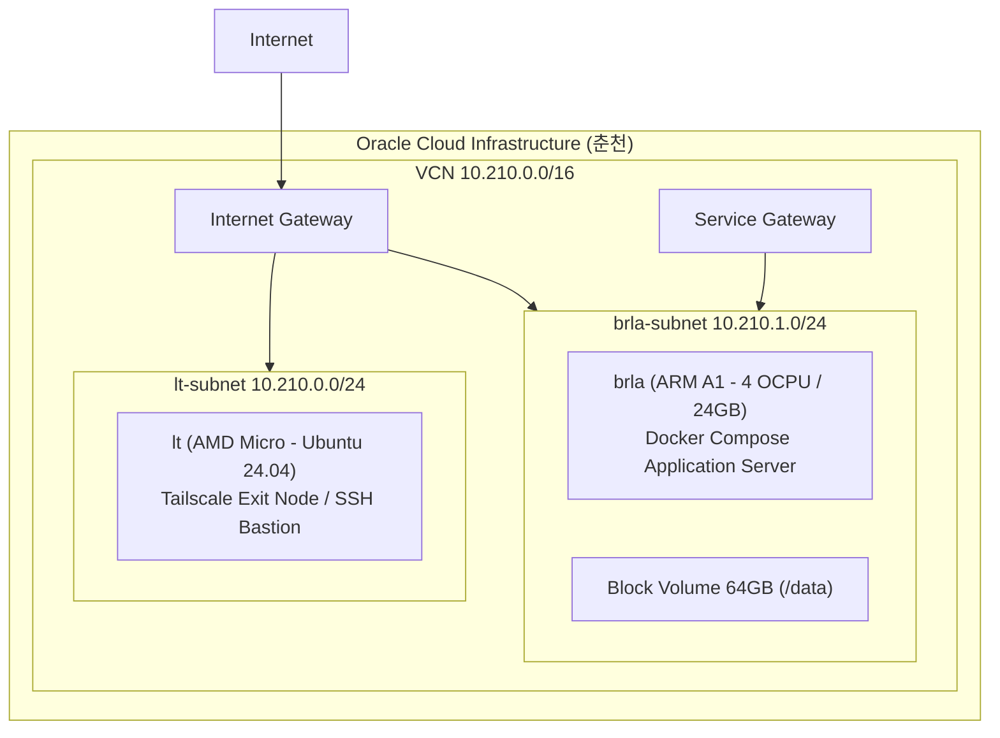
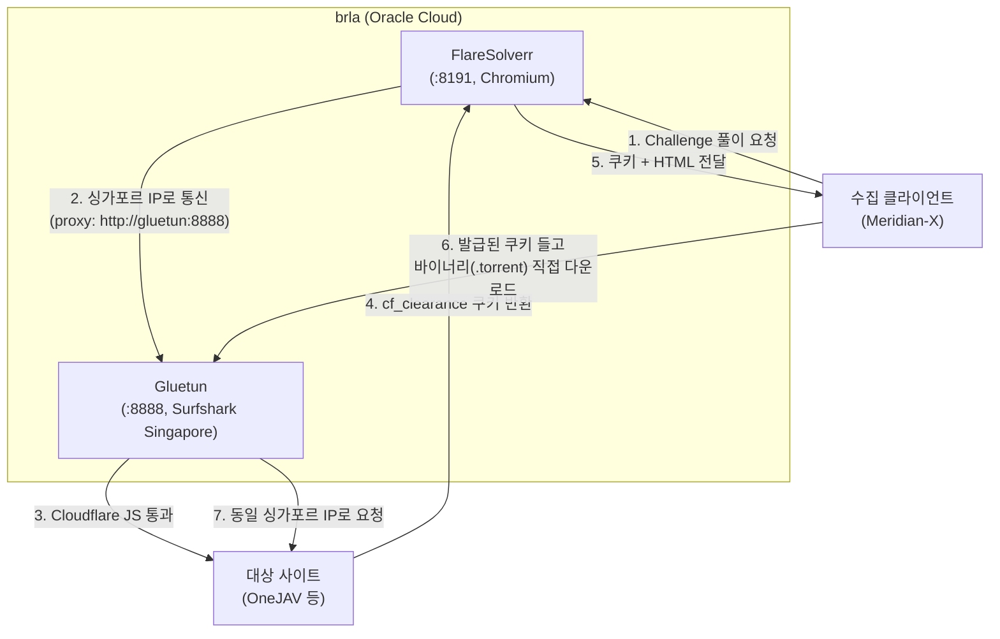

# 247365

OCI Free-Tier(AMD Micro + ARM A1) 기반의 상시 운영(24/7/365) 개인 클라우드 인프라 프로젝트입니다. Web 브라우저만으로 안전하게 개발할 수 있는 환경을 OpenTofu와 Ansible로 자동 프로비저닝하며, Tailscale HTTPS 기반의 code-server, Hermes AI Agent, 모니터링 대시보드(Homepage, Gatus, Beszel) 및 해외 우회 프록시(Gluetun, FlareSolverr)를 통합 운영합니다.

## 📚 문서 디렉토리 (Diátaxis Index)

### 🚀 Tutorials (입문)
- [Quick Start](#quick-start) - SOPS 시크릿 복호화부터 전체 자동 배포까지 초심자 가이드

### 🛠️ How-To Guides (가이드)
- [Ansible 플레이북 실행](#4-ansible-설정-적용) - 서비스 배포, 재부팅 및 헬스 체크 절차

### 📋 Reference (참고자료)
- [프로젝트 구조](#구조) - Repository 디렉토리 및 파일 역할 정의
- [Monitoring Dashboard](#monitoring-dashboard) - BRL-A 대시보드 및 Monitoring 스택 사양
- [AI Agent (Hermes)](#ai-agent-hermes) - LLM 에이전트 런타임 및 대시보드 사양
- [Network Proxy & Bypass](#network-proxy--anti-bot-bypass-gluetun--flaresolverr) - Gluetun VPN 및 FlareSolverr 차단 우회 스택
- [문서 허브 (docs/README.md)](./docs/README.md) - 저장소 하위 문서 디렉토리 안내

### 💡 Explanation (설명)
- [인프라 아키텍처](#architecture) - VCN, 인스턴스 토폴로지 및 네트워크 흐름

## Quick Start

```bash
# 사전 준비: keys.txt (age 개인키)를 프로젝트 루트에 배치
# 사전 준비: sops, age, tofu (opentofu), ansible 설치

# 1. SOPS 유틸리티 로드
source .env.local

# 2. 시크릿 복호화
dec        # .env.sops → .env
load       # 쉘 환경에 변수 주입

# 3. 전체 배포 (복호화 + tfvars 생성 + tofu apply + hosts.ini 생성)
bash setup.sh

# 4. Ansible 설정 적용
cd ansible
ansible-playbook playbook-lt.yml      # lt: Tailscale exit node
ansible-playbook playbook-brla.yml    # brla: Docker + code-server + monitoring + Hermes
```

## 구조

```
.env.sops          # 암호화된 시크릿 (git 추적)
.env.local         # SOPS 유틸리티 (sops-dec/enc/load 함수 + alias)
setup.sh           # 전체 배포 (.env.local 호출 → tfvars 생성 → tofu)
opentofu/          # OpenTofu (VCN, Compute, Storage)
ansible/           # Ansible (Tailscale, Docker, code-server, monitoring, Hermes)
.devcontainer/     # Codespaces 설정
```

## Architecture



- **lt (조명 로봇)**: 공용 IP를 보유한 최소 사양 관리 노드. Tailscale Exit Node 및 SSH ProxyJump Bastion 역할.
- **brla (파라솔 로봇)**: 사설 서브넷에 위치하며 64GB 블록 볼륨(`/data`)을 마운트해 Docker Compose 서비스 구동. Tailscale 암호화 터널을 통해서만 접근.

## Monitoring Dashboard

`brla`에는 Heritage 설정을 복사한 Homepage/Gatus와 새 Beszel Hub를 배포한다.
기존 Heritage 배포와 설정은 그대로 유지한다.

| 서비스 | URL | 이전 범위 |
| :--- | :--- | :--- |
| Homepage | `https://brla.bun-bull.ts.net` | Heritage 설정 복사 |
| code-server | `https://brla.bun-bull.ts.net:8080` | 개발 환경 (Tailscale HTTPS) |
| Gatus | `https://brla.bun-bull.ts.net:8088` | endpoint 설정 복사, 이력 DB 신규 생성 |
| Beszel | `https://brla.bun-bull.ts.net:8090` | 계정과 데이터 모두 신규 생성 |

Homepage의 Transmission/Jellyfin/Aria2 링크는 기존 Heritage 서비스를 계속
가리킨다. Gatus와 Beszel 런타임 데이터는 대상 호스트에서 새로 생성된다.
새 Beszel 계정은 SOPS의 `HOMEPAGE_VAR_BESZEL_USERNAME` 및
`HOMEPAGE_VAR_BESZEL_PASSWORD`와 일치하게 생성하거나 해당 값을 갱신해야 한다.

## AI Agent (Hermes)

`brla`에 `nousresearch/hermes-agent` 컨테이너(`network_mode: host`)를 배포한다.
AI provider는 Tailscale Aperture를 경유하며,
`deuxksy/ai-brla` repo에 일 1회(03:10) SQLite dump를
자동 백업한다. 컨테이너는 UID 10000으로 `/data/hermes/data`를 소유한다.

| 컴포넌트 | 포트 | URL |
| :--- | :--- | :--- |
| Gateway | `8642` | health check용 (`127.0.0.1` bind, 컨테이너 내부) |
| Dashboard | `9119` | `https://brla.bun-bull.ts.net:9119` (basic_auth) |

Dashboard는 컨테이너 내 `9120` 포트에서 basic_auth로 동작하고(`HOST=0.0.0.0`),
Tailscale Serve가 `9119` HTTPS로 종단하여 `127.0.0.1:9120`으로 프록시한다.
인증 정보는 SOPS의 `HERMES_DASHBOARD_BASIC_AUTH_USERNAME` /
`HERMES_DASHBOARD_BASIC_AUTH_PASSWORD`를 사용한다.

## Network Proxy & Anti-Bot Bypass (Gluetun & FlareSolverr)

`brla`에 해외 egress 프록시(**Gluetun**)와 Cloudflare 챌린지 우회용 헤드리스 브라우저(**FlareSolverr**)를 배포하여, 외부 수집기(Meridian-X 등)의 검열 회피 및 봇 차단 우회 경로를 제공한다.

| 서비스 | 컨테이너 | 내부/Tailnet 포트 | 역할 및 특성 |
| :--- | :--- | :--- | :--- |
| Gluetun | `gluetun` | `8888` (HTTP Proxy), `8000` (Control) | Surfshark WireGuard 기반 VPN 터널. IP 변경 및 해외(Singapore) egress 제공 |
| FlareSolverr | `flaresolverr` | `8191` (HTTP API) | Headless Chromium 런타임. Cloudflare JS Challenge/봇 감지 해결 |

### Gluetun vs FlareSolverr 차이점 및 협동 구조

* **Gluetun (네트워크 L3/L4/L7 Proxy 계층)**:
  - **역할**: WireGuard VPN 터널로 트래픽의 출발지 IP(Egress IP)를 싱가포르 등 해외로 전환.
  - **해결 범위**: 한국 ISP/정부의 단순 IP 차단, 방통위 SNI 차단, 해외 지역 제한(Geo-block) 우회.
  - **한계**: Cloudflare의 브라우저 무결성 검사(JS Challenge, 403 Forbidden)는 IP 변경만으로 통과 불가.
* **FlareSolverr (애플리케이션 L7 Browser 계층)**:
  - **역할**: 실제 Chromium 브라우저를 띄워 자바스크립트 실행 및 핑거프린트 검증을 통과하고 `cf_clearance` 쿠키/HTML 반환.
  - **해결 범위**: Cloudflare 봇 감지 및 JS Challenge 통과.
  - **한계**: 자체 VPN 기능이 없어 한국 IP에서 직접 실행 시 ISP 차단에 걸림. 또한 `.torrent` 등 바이너리 파일 직접 다운로드 불가.



> **IP 바인딩 주의**: Cloudflare의 `cf_clearance` 쿠키는 챌린지를 통과한 Egress IP와 바인딩되므로, FlareSolverr가 경유한 Gluetun 프록시와 클라이언트가 바이너리를 다운로드할 때 사용하는 Gluetun 프록시는 동일해야 합니다.
